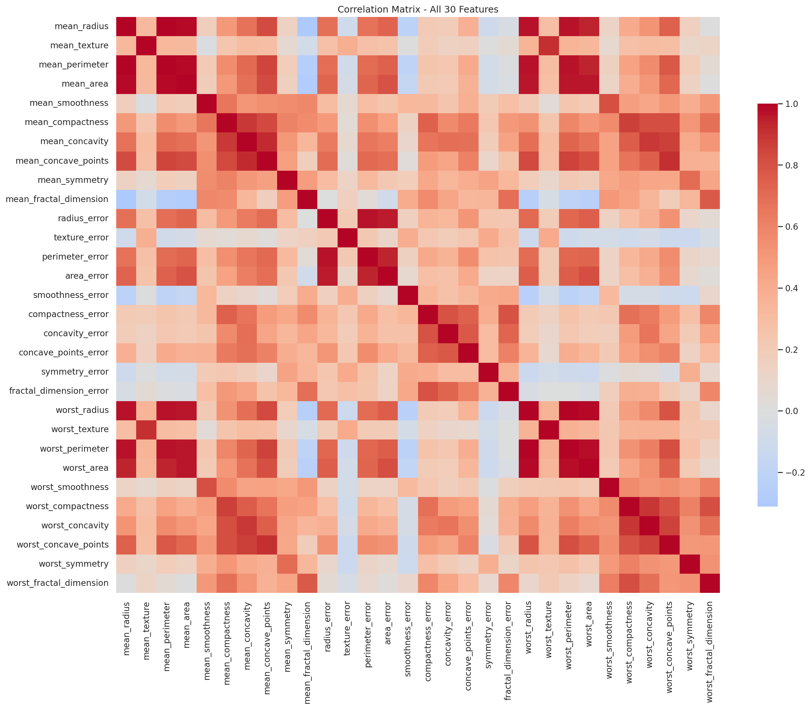
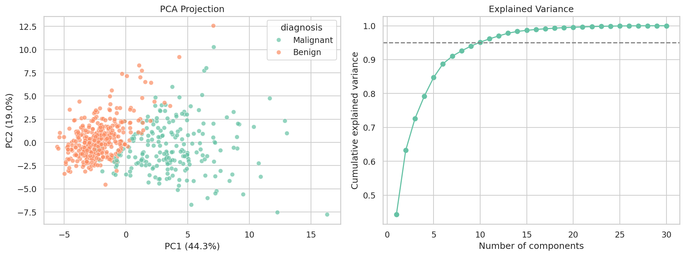

# Exploratory Data Analysis (EDA) Project

Analyze a dataset to uncover patterns and trends - here, the **Breast Cancer Wisconsin (Diagnostic)** dataset (569 tumour samples, 30 measurements each).

[Watch Task Tutorial](https://youtu.be/xi0vhXFPegw?si=pyu6D7niFFT0qk2a)

## Key Features

- **Statistical summaries** - descriptive statistics, skewness, kurtosis, data-quality checks, IQR outlier detection
- **Visualizations** - class balance, distributions, boxplots, correlation heatmap, pairplot, PCA
- **Correlations and key influencing factors** - Pearson correlation, multicollinearity analysis, Welch t-test / Mann-Whitney U with Cohen's d, random-forest feature importance
- **Structured report** - full written findings in [`reports/EDA_Report.md`](reports/EDA_Report.md)

## Headline Findings

| Finding | Result |
|---|---|
| Dataset | 569 rows x 31 columns, 0 missing values, 0 duplicates |
| Class balance | 357 benign (62.7%) / 212 malignant (37.3%) |
| Strongest single predictor | `worst_concave_points` (r = 0.79, Cohen's d = 2.60) |
| Statistically significant features | 26 of 30 (p < 0.05) |
| Multicollinearity | 21 feature pairs with abs(r) > 0.9 (e.g. radius vs perimeter, r = 0.998) |
| Dimensionality | 10 principal components retain 95% of the variance |
| Baseline classifier | Random forest reaches 95.8% hold-out accuracy |




## Repository Structure

```
.
├── data/
│   └── breast_cancer.csv          # dataset exported from scikit-learn
├── src/
│   └── eda.py                     # full analysis script
├── figures/                       # 8 generated charts
├── reports/
│   ├── EDA_Report.md              # written report with insights
│   └── *.csv                      # summary tables (stats, correlations, tests, importances)
├── requirements.txt
└── README.md
```

## How to Run

```bash
git clone <your-repo-url>
cd eda-breast-cancer-analysis
pip install -r requirements.txt
python src/eda.py
```

The script regenerates every figure in `figures/` and every table in `reports/`.

## Tools

Python, pandas, NumPy, Matplotlib, Seaborn, SciPy, scikit-learn

## Outcome

Practised the full EDA workflow: data-quality checks, statistical summaries, visual exploration, correlation and hypothesis testing, feature ranking, and communicating insights in a structured report.

## Disclaimer

This is a learning project. The findings describe a public teaching dataset and are not medical advice.
