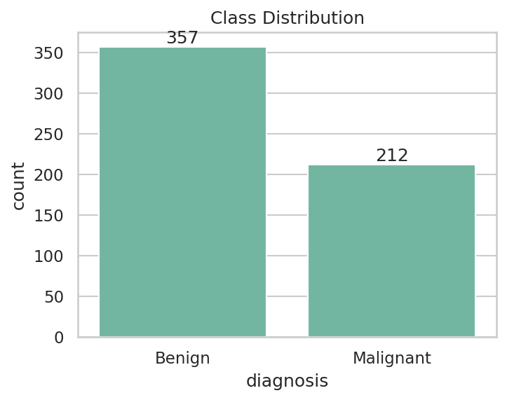
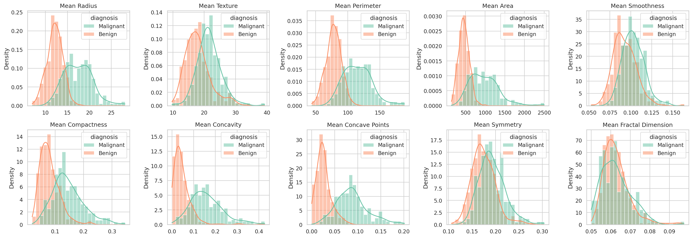
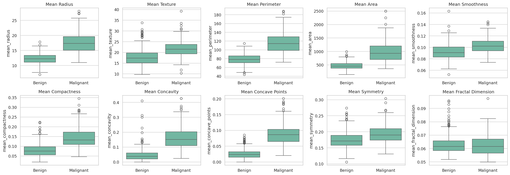
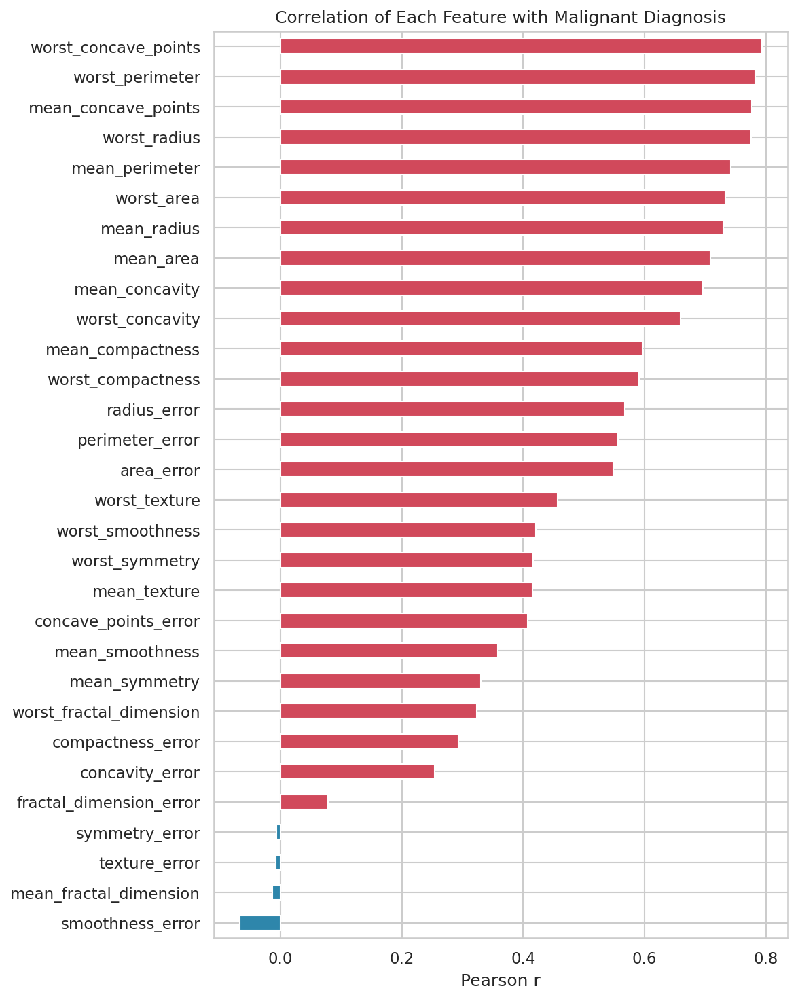
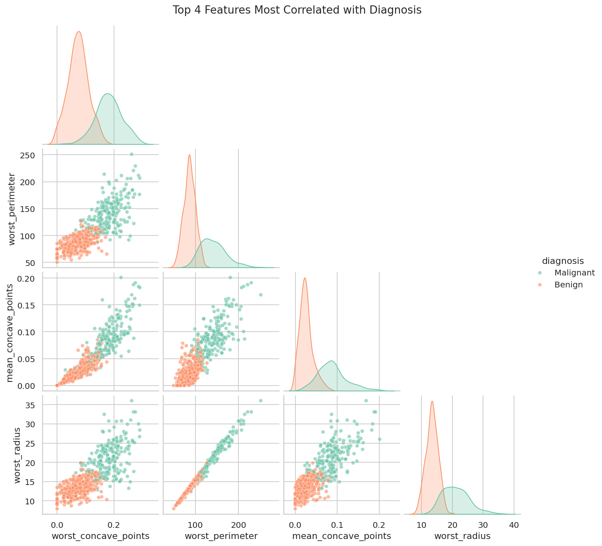
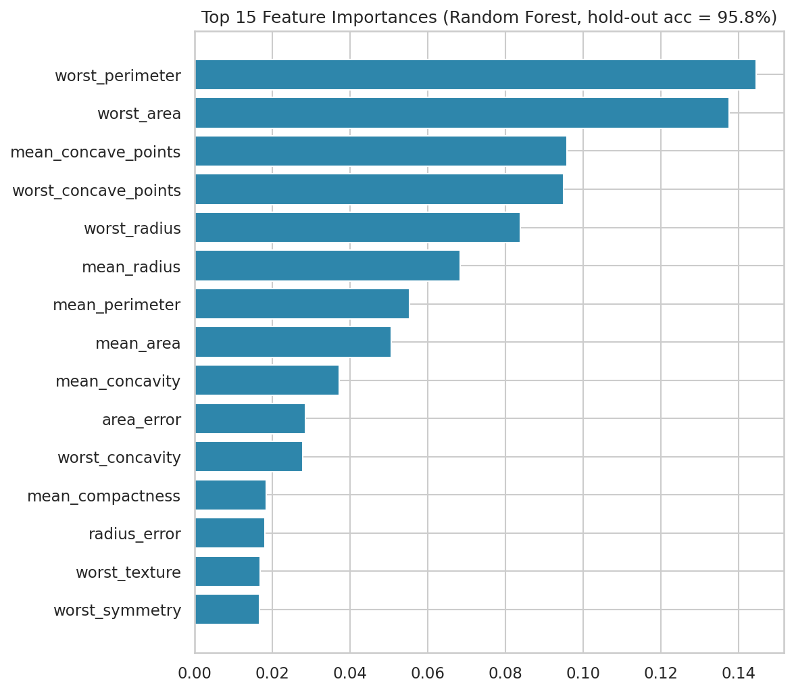

# EDA Report: Breast Cancer Wisconsin (Diagnostic) Dataset

## 1. Objective

Explore the dataset to understand its structure, find patterns separating **malignant** from **benign** tumours, identify correlated variables, and determine which measurements influence the diagnosis most.

## 2. Dataset Overview

- **Source:** Built into scikit-learn (`load_breast_cancer`), originally from the UCI Machine Learning Repository.
- **Size:** 569 samples, 30 numeric features, 1 label (`diagnosis`).
- **Features:** Ten cell-nucleus characteristics (radius, texture, perimeter, area, smoothness, compactness, concavity, concave points, symmetry, fractal dimension), each given as **mean**, **standard error** and **worst** (largest) value.
- **Target:** 357 benign (62.7%), 212 malignant (37.3%).



## 3. Data Quality

| Check | Result |
|---|---|
| Missing values | 0 |
| Duplicate rows | 0 |
| Data types | All 30 features numeric (float) |

The data is clean, so no imputation or deduplication was needed. The classes are moderately imbalanced (about 63/37), which is mild enough that accuracy is still a reasonable metric.

## 4. Statistical Summary

Full table: [`summary_statistics.csv`](summary_statistics.csv).

- `mean_radius` ranges from 6.98 to 28.11 (mean 14.13, SD 3.52); `mean_area` from 143.5 to 2501 (mean 654.9, SD 351.9).
- Features sit on very different scales (area is in the hundreds, smoothness below 0.2), so **standardisation is required** before distance-based methods or PCA.
- The most right-skewed features are `area_error` (skew 5.45), `concavity_error` (5.11) and `fractal_dimension_error` (3.92). The "error" features generally have long tails.



## 5. Outliers

Using the 1.5 x IQR rule, **171 of 569 rows (30%)** contain at least one outlier. The worst offenders are `area_error` (65 outliers), `radius_error` and `perimeter_error` (38 each) and `worst_area` (35).

These are not data-entry errors. They reflect genuinely large tumours and the natural skew of size measurements, and large values are concentrated in the malignant class. They were therefore **kept**, not removed. If a model is sensitive to extreme values, a log transform or robust scaling would be a better remedy than deletion.



## 6. Correlation Analysis

### 6.1 Relationships between features (multicollinearity)


- **21 feature pairs** have |r| > 0.9. The strongest: `mean_radius` vs `mean_perimeter` (r = 0.998), `worst_radius` vs `worst_perimeter` (0.994), `mean_radius` vs `mean_area` (0.987).
- This is geometric: radius, perimeter and area all measure tumour size, so they carry largely the same information.
- Consequence: many of the 30 features are redundant. A model needs far fewer than 30 independent signals (see PCA below).

### 6.2 Relationship with diagnosis

Pearson correlation with malignancy (1 = malignant):

| Feature | r |
|---|---|
| worst_concave_points | 0.794 |
| worst_perimeter | 0.783 |
| mean_concave_points | 0.777 |
| worst_radius | 0.776 |
| mean_perimeter | 0.743 |
| worst_area | 0.734 |

Size features (radius, perimeter, area) and **concave points** (the number of concave portions of the cell contour) show the strongest positive association with malignancy.





## 7. Statistical Testing: Malignant vs Benign

Each feature was compared between classes with Welch's t-test and the Mann-Whitney U test (non-parametric, suited to skewed data). Effect size is Cohen's d. Full table: [`group_comparison_tests.csv`](group_comparison_tests.csv).

- **26 of 30 features** differ significantly (p < 0.05).
- The four that do **not**: `smoothness_error` (p = 0.105), `mean_fractal_dimension` (p = 0.767), `texture_error` (p = 0.835), `symmetry_error` (p = 0.887).
- Largest effects (|d| above 2 is considered very large):

| Feature | Mean (malignant) | Mean (benign) | Cohen's d |
|---|---|---|---|
| worst_concave_points | 0.182 | 0.074 | 2.60 |
| worst_perimeter | 141.4 | 87.0 | 2.37 |
| mean_concave_points | 0.088 | 0.026 | 2.33 |
| worst_radius | 21.1 | 13.4 | 2.32 |
| mean_perimeter | 115.4 | 78.1 | 2.12 |
| mean_radius | 17.5 | 12.1 | 2.05 |

Malignant tumours are on average about 44% larger in mean radius and have roughly double the mean area (978 vs 463).

## 8. Key Influencing Factors (Feature Importance)

A random forest (300 trees, 75/25 stratified split) reached **95.8% hold-out accuracy**, used here as a tool to rank features, not as a final model.

| Rank | Feature | Importance |
|---|---|---|
| 1 | worst_perimeter | 0.144 |
| 2 | worst_area | 0.138 |
| 3 | mean_concave_points | 0.096 |
| 4 | worst_concave_points | 0.095 |
| 5 | worst_radius | 0.084 |



**Important caveat:** permutation importance for these same features was close to zero. This does not mean they are unimportant. Because radius, perimeter and area are almost perfectly correlated, shuffling one leaves the others to compensate. Importance is therefore effectively **shared across a group of redundant features**, and individual rankings within the size group should not be over-interpreted.

## 9. Dimensionality Reduction (PCA)

After standardisation:

- PC1 explains **44.3%** of the variance and PC2 **19.0%**.
- **10 components** are enough to retain 95% of the variance (down from 30).
- A 2-D projection already separates the two classes well, with overlap only in a boundary region.


## 10. Key Insights

1. **Clean but redundant data.** No missing values or duplicates, but many features are near-duplicates of each other.
2. **Tumour size and shape irregularity drive the diagnosis.** Radius, perimeter, area and especially concave points are the strongest separators.
3. **Worst-case values matter more than average values.** The "worst" features have the highest correlations and effect sizes, so the most extreme cells in a sample are very informative.
4. **Some features carry almost no signal.** Fractal dimension (mean), texture error and symmetry error show no meaningful difference between classes.
5. **Outliers are real signal.** They mostly come from large malignant tumours, so removing them would discard useful information.
6. **The classes are largely separable.** Both PCA and a simple random forest separate them well, indicating a strong predictive signal.

## 11. Recommendations for Next Steps

- Drop or combine redundant size features (for example keep one of radius / perimeter / area) or use PCA to reduce multicollinearity.
- Standardise features before modelling; consider a log transform for the skewed "error" features.
- Use cross-validation and report precision / recall, since in a medical setting missing a malignant case is costlier than a false alarm.
- Compare several models (logistic regression, SVM, gradient boosting) on the reduced feature set.

## 12. Limitations

- Small dataset (569 samples) from a single source, so results may not generalise.
- Correlation does not imply causation.
- This is an educational exercise and not a clinical tool.

## 13. How to Reproduce

```bash
pip install -r requirements.txt
python src/eda.py
```
